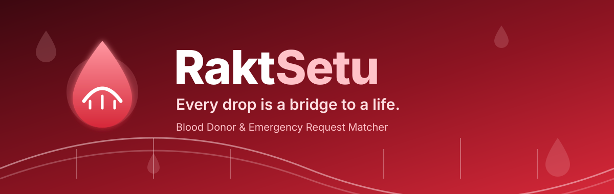
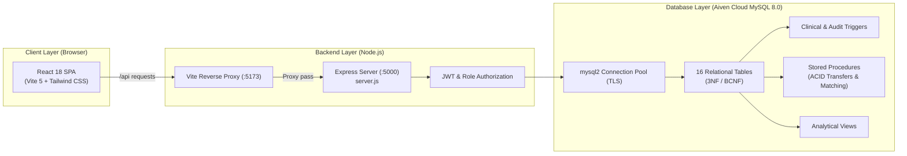

<div align="center">



<br/>


-4479A1?style=for-the-badge&logo=mysql&logoColor=white)


-E63946?style=for-the-badge)

### 🩸 *Hospitals raise a request → we match compatible, eligible donors in the same city → donors respond → donations & stock stay in sync.*

[**Quick Start**](#-quick-start) · [**Live Credentials**](#-live-authentication-credentials) · [**DBMS Features**](#-advanced-rdbms-features) · [**Architecture**](#-full-stack-architecture) · [**API Endpoints**](#-rest-api-endpoints)

</div>

---

## 📖 Table of Contents

- [About RaktSetu](#-about-raktsetu)
- [Quick Start & Setup](#-quick-start--setup)
- [Live Authentication Credentials](#-live-authentication-credentials)
- [System Architecture](#-system-architecture)
- [Advanced RDBMS Features (CS203 Syllabus)](#-advanced-rdbms-features)
  - [Relational Schema & Normalization (3NF / BCNF)](#1-relational-schema--normalization-3nf--bcnf)
  - [Automated Triggers](#2-automated-triggers)
  - [ACID Stored Procedures](#3-acid-stored-procedures)
  - [Analytical Views](#4-analytical-views)
- [REST API Endpoints](#-rest-api-endpoints)
- [End-to-End Workflow & Demo Guide](#-end-to-end-workflow--demo-guide)
- [Project Directory Structure](#-project-directory-structure)

---

## 💡 About RaktSetu

> *Rakt* = blood · *Setu* = bridge  
> **Course:** CS203 Database Management Systems | SVNIT Surat

In an emergency, finding compatible blood is often a chaotic process of phone calls and social media forwards. **RaktSetu** bridges this gap with a modern, full-stack relational platform connecting **Donors**, **Hospitals & Blood Banks**, and **System Administrators**:

| Problem Today | Solution with RaktSetu |
|---|---|
| Unverified donor lists & spam calls | Real-time ABO/Rh compatibility matching with city proximity |
| Ineligible donations causing clinical risk | **90-day clinical cooldown** trigger enforced strictly by MySQL |
| Donor privacy concerns | Donor phone numbers stay private until the donor explicitly accepts a request |
| Hospital stockouts & expired units | Real-time inventory tracking, low-stock alerts, and auto-unit creation |
| Lack of auditability | Automated trigger-driven audit trail (`audit_logs`) tracking all state changes |

---

## 🚀 Quick Start & Setup

### Prerequisites
- [Node.js (v18+)](https://nodejs.org/)
- Cloud or local MySQL instance (Aiven Cloud MySQL credentials configured in `.env`)

### 1. Installation
Clone the repository and install all dependencies:
```bash
git clone https://github.com/lavanyachoukiker8/RaktSetu.git
cd RaktSetu
npm install
```

### 2. Environment Configuration
Verify your `.env` configuration file in the project root:
```env
# 1. Database Connection (Aiven Cloud MySQL)
MYSQL_HOST=mysql-1151a67-raktsetu-web.d.aivencloud.com
MYSQL_PORT=15435
MYSQL_DATABASE=defaultdb
MYSQL_USER=avnadmin
MYSQL_PASSWORD=your_aiven_password
DB_SSL=true

# 2. JWT Secret Key for Session Authentication
JWT_SECRET=raktsetu_super_secret_jwt_key_2026

# 3. Frontend API Proxy URL
VITE_API_URL=http://localhost:5000
```

### 3. Database Initialization & Migration (Optional)
To run or re-seed the cloud database with full schemas, triggers, views, procedures, and seed records:
```bash
# Automated 1-click migrator to Aiven MySQL
npm run db:migrate

# Inspect table row counts and live records
npm run db:view
```

### 4. Running the Application

Open two terminal windows:

**Terminal 1 — Backend API Server:**
```bash
npm run server
```
*Starts the Express REST API server on `http://localhost:5000` with database connection pooling and health checks (`/api/health`).*

**Terminal 2 — Frontend Application:**
```bash
npm run dev
```
*Starts the Vite development server on `http://localhost:5173`. Open this URL in your web browser.*

---

## 🔐 Live Authentication Credentials

The system features real password hashing with `bcrypt` (salt rounds: 10) and signed JWT tokens with 7-day expiration. You can either register new accounts or use existing seeded accounts:

| Role | Sign In / Registration | Seed Credentials | Accessible Features |
| :--- | :--- | :--- | :--- |
| **Donor** | Click **"Become a donor"** (`/register/donor`) | **ID:** `9876543210` or `donor`<br>**Pass:** `donor123` | View nearby requests, accept/decline, badges & leaderboard, donation history, availability toggle, profile update |
| **Hospital** | Click **"Register a hospital"** (`/register/hospital`) | **ID:** `bloodbank@civilsurat.gov.in` or `hospital`<br>**Pass:** `hospital123` | Create emergency requests, view smart donor matches, notify donors, record donations, manage stock & thresholds, inter-hospital transfers |
| **Administrator** | Direct login | **ID:** `admin` or `admin@raktsetu.org`<br>**Pass:** `admin123` | System-wide dashboard, hospital approval/rejection, donor management, camp CRUD, audit trail inspections |

---

## 🏗️ System Architecture



---

## 🎓 Advanced RDBMS Features

### 1. Relational Schema & Normalization (3NF / BCNF)
The database schema ([`database/schema.sql`](database/schema.sql)) comprises **16 normalized tables**:
- **Reference Tables:** `blood_groups` (with rarity flags), `cities` (with geo-coordinates for distance calculation), `roles`.
- **Entities:** `users`, `donors`, `hospitals`, `units` (individual barcoded blood bags with expiration dates), `requests`, `donations`, `camps`.
- **Junction & Audit Tables:** `inventory_thresholds` (composite primary key), `request_notified`, `request_accepted`, `request_declined`, `camp_registrations`, `transfers`, and `audit_logs`.
- **Integrity Constraints:**
  - Foreign keys with `ON UPDATE CASCADE` and `ON DELETE RESTRICT/SET NULL/CASCADE`.
  - Domain constraints: `chk_donor_phone` (10-digit regex), `chk_donor_weight >= 45.0 kg`, `chk_unit_expiry > collected_at`, `chk_req_units BETWEEN 1 AND 10`.

### 2. Automated Triggers
- **`trg_check_donation_cooldown` (BEFORE INSERT on `donations`):**
  Clinically enforces the mandatory 90-day cooldown period. If a donor attempts to donate blood before 90 days have elapsed since their previous donation, the trigger raises an SQL exception:
  ```sql
  SIGNAL SQLSTATE '45000' SET MESSAGE_TEXT = 'Clinical violation: Donor must wait 90 days between donations.';
  ```
- **`trg_check_donor_age` (BEFORE INSERT on `donors`):**
  Validates that donor age calculated via `TIMESTAMPDIFF(YEAR, NEW.dob, CURDATE())` is strictly between 18 and 65 years.
- **`trg_after_donation_completed` (AFTER INSERT on `donations`):**
  Automatically updates the donor's `last_donation`, computes `next_eligible_date` (+90 days), increments `donation_count`, generates a unique barcode, and inserts a new unit bag into `units` with a 42-day whole blood shelf life.
- **`trg_audit_request_status` & `trg_audit_hospital_status`:**
  Automatically logs any status changes into `audit_logs` for compliance and auditability.

### 3. ACID Stored Procedures
- **`sp_interhospital_transfer`:**
  Executes inter-hospital stock transfers within an explicit transaction block:
  ```sql
  START TRANSACTION;
    UPDATE `units` SET `hospital_id` = p_dest_hospital_id WHERE `id` = p_unit_id;
    INSERT INTO `transfers` (...) VALUES (...);
  COMMIT;
  ```
  Guarantees atomicity and rolls back on `SQLEXCEPTION` if the unit is expired or already transferred.
- **`sp_match_emergency_donors`:**
  Evaluates recipient ABO/Rh compatibility, city location, active availability, and the 90-day cooldown, ranking exact matches first followed by elapsed days since last donation.

### 4. Analytical Views
- **`v_blood_stock_summary`:**
  Aggregates unit counts per blood group per hospital, checking `expiry > NOW()`, joined with `inventory_thresholds` to compute real-time stock flags (`ADEQUATE`, `LOW_STOCK`, `OUT_OF_STOCK`).
- **`v_donor_leaderboard`:**
  Ranks donors using `DENSE_RANK() OVER (ORDER BY donation_count DESC)` and dynamically awards badges (**Bronze** for 3+, **Silver** for 5+, **Gold** for 10+ donations).
- **`v_eligible_donors`:**
  Filters clinically eligible donors based on weight, age, and cooldown.

---

## 📡 REST API Endpoints

All endpoints are hosted on `http://localhost:5000` and proxied through Vite:

| Category | Method & Endpoint | Description | Access |
| :--- | :--- | :--- | :--- |
| **Auth** | `POST /api/auth/login` | Login with username, email, or 10-digit phone; returns JWT | Public |
| **Auth** | `POST /api/donors/register` | Register new donor with health screening & password hash | Public |
| **Auth** | `POST /api/hospitals/register` | Register new hospital awaiting verification | Public |
| **Stats** | `GET /api/stats` | Summary counts (active donors, donations, open requests) | Public |
| **Stats** | `GET /api/stats?detail=1` | Stock by blood group, 6-month trend, request statuses | Public |
| **Donors** | `GET /api/donors` | Filter donors by group, city, availability, and search | Public |
| **Donors** | `GET /api/donors/count` | Count available compatible donors in city | Public |
| **Donors** | `GET /api/donors/leaderboard` | Top donors and badges from analytical view | Public |
| **Donors** | `GET /api/donors/:id` | Detailed donor profile | Authenticated |
| **Donors** | `PUT /api/donors/:id` | Update profile details | Donor / Admin |
| **Donors** | `PUT /api/donors/:id/availability` | Toggle donation availability | Donor |
| **Donors** | `PUT /api/donors/:id/active` | Activate / deactivate donor account | Admin |
| **Requests** | `GET /api/requests` | List emergency requests with filter options | Public |
| **Requests** | `POST /api/requests` | Create emergency blood request | Hospital / Public |
| **Requests** | `GET /api/requests/:id/matches` | Execute `sp_match_emergency_donors` ranking | Hospital / Admin |
| **Requests** | `POST /api/requests/:id/notify` | Notify matched donors | Hospital / Admin |
| **Requests** | `POST /api/requests/:id/respond` | Accept or decline request (reveals phone on accept) | Donor |
| **Requests** | `POST /api/requests/:id/fulfill` | Fulfill request & deduct units from inventory | Hospital / Admin |
| **Requests** | `POST /api/requests/:id/cancel` | Cancel open emergency request | Hospital / Admin |
| **Donations** | `POST /api/donations` | Record donation, check cooldown, trigger unit creation | Hospital |
| **Inventory**| `GET /api/inventory` | Blood stock levels, thresholds & unit bag details | Public |
| **Inventory**| `PUT /api/inventory/threshold` | Update hospital low-stock threshold | Hospital / Admin |
| **Camps** | `GET /api/camps` | List blood donation camps with registration counts | Public |
| **Camps** | `POST /api/camps/:id/register` | Donor registration for a donation drive | Donor |
| **Transfers**| `GET /api/transfers` | View inter-hospital transfer history | Hospital / Admin |
| **Transfers**| `POST /api/transfers` | Atomic transfer via `sp_interhospital_transfer` | Hospital / Admin |
| **Reports** | `GET /api/reports/monthly` | Donations, requests, and top donor analytics | Hospital / Admin |
| **Audit** | `GET /api/audit` | Comprehensive system audit log | Admin |
| **Health** | `GET /api/health` | Server and database health check | Public |

---

## 🎯 End-to-End Workflow & Demo Guide

During project viva / examination, follow this 3-minute sequence:

1. **Demonstrate Public Portal & Live Stats**:
   - Open `http://localhost:5173`. Point out real-time stats (Active Donors, Total Donations, Open Requests) powered by `GET /api/stats`.
   - Use the **Find Blood** tool to check hospital blood availability in Surat or Ahmedabad.
2. **Register a New Donor (Input Validation & Normalization)**:
   - Click **Become a donor** and submit details with a valid 10-digit mobile number.
   - Show how the donor record is created with hashed credentials and dynamic eligibility evaluation.
3. **Emergency Blood Request & Stored Procedure Matching**:
   - Log in as **Hospital** (`hospital` / `hospital123`).
   - Create an emergency request for `B+` blood with `CRITICAL` urgency.
   - Click **View Matches** to show the execution of `sp_match_emergency_donors`, highlighting the ranking of exact vs. compatible donors.
   - Click **Notify All** to record notification timestamps in the database.
4. **Donor Response (Privacy Guarantee)**:
   - Log in as **Donor** (`donor` / `donor123`).
   - View the pending request from the hospital.
   - Click **Accept Request** — notice that the hospital contact details are now revealed.
5. **Recording Donation & Trigger Execution**:
   - Switch back to the hospital view and navigate to **Record Donation**.
   - Record 1 unit for the donor.
   - Demonstrate that the `trg_after_donation_completed` trigger updated the donor's `donation_count`, set the 90-day cooldown, and added a new barcoded unit into `units`.
6. **Admin Dashboard & Audit Trail**:
   - Log in as **Admin** (`admin` / `admin123`).
   - Show the analytical charts (Stock by group, Monthly requests).
   - Show the **Audit Log** to demonstrate that all state transitions were recorded automatically.

---

## 📁 Project Directory Structure

```
RaktSetu/
├── api/                           # Serverless endpoint handlers
│   ├── middleware/auth.js         # JWT verification & role authorization
│   ├── auth.js                    # Auth endpoints (login, registration)
│   ├── camps.js                   # Camps CRUD
│   ├── db.js                      # MySQL connection pool (Aiven Cloud TLS)
│   ├── donors.js                  # Donor profiles, eligibility, leaderboard
│   ├── hospitals.js               # Hospital verification & profiles
│   ├── requests.js                # Emergency requests & matching
│   └── transfers.js               # Inter-hospital stock transfers
├── certs/
│   └── ca.pem                     # Aiven Cloud MySQL CA certificate
├── database/                      # Relational DBMS scripts & tools
│   ├── schema.sql                 # 16 tables, PK/FK constraints, check rules
│   ├── reference-data.sql         # Blood groups, cities, roles
│   ├── triggers_and_views.sql     # Cooldown triggers, audit triggers, views, procedures
│   ├── seed.sql                   # Realistic donors, hospitals, units, requests
│   ├── import_to_aiven.js         # Automated Aiven migration script
│   ├── view_aiven.js              # Table row-count and sample viewer
│   └── verify_database.sql        # Viva examination test suite
├── src/                           # Frontend React 18 Application
│   ├── api/                       # Axios HTTP client & API bindings
│   ├── components/                # Reusable UI components (Tables, Charts, Forms)
│   ├── context/                   # AuthContext with JWT persistence
│   ├── pages/                     # Donor, Hospital, and Admin portals
│   └── App.jsx                    # Route definitions
├── server.js                      # Production Express backend server (:5000)
├── vite.config.js                 # Vite configuration with /api reverse proxy
├── package.json                   # Dependencies & npm scripts
└── README.md                      # Comprehensive project documentation
```

---

<div align="center">
Made with ❤️ for <b>CS203 DBMS Course | SVNIT Surat</b>
</div>
