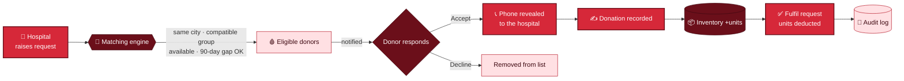
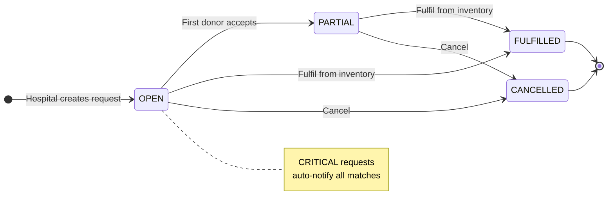
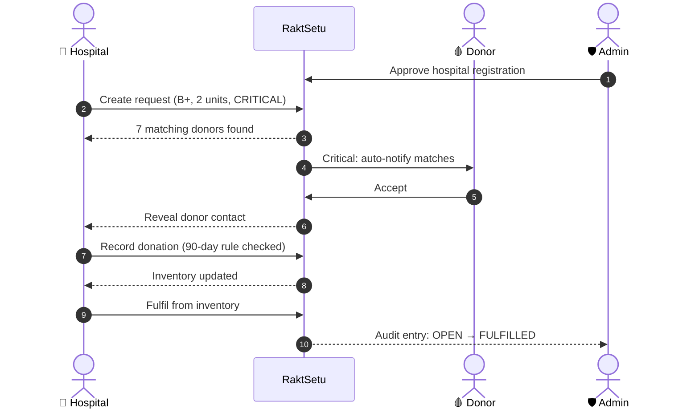
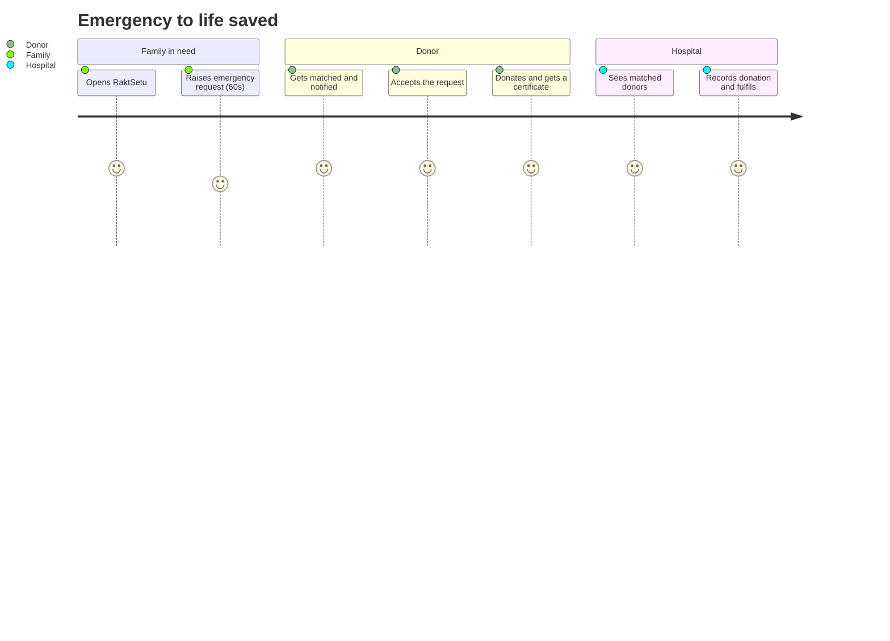
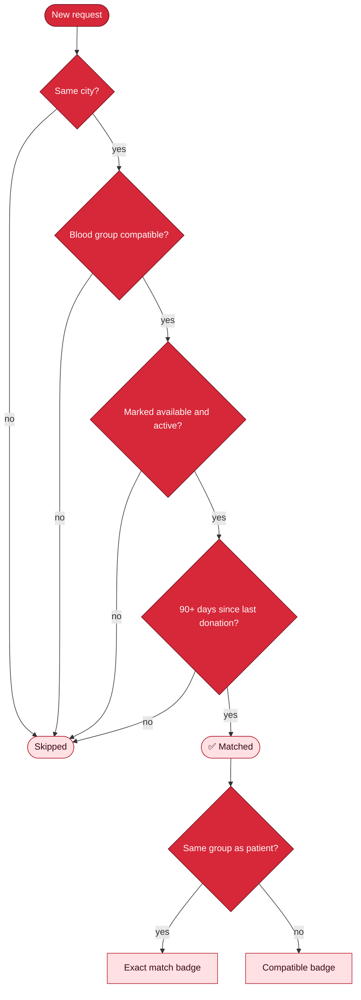
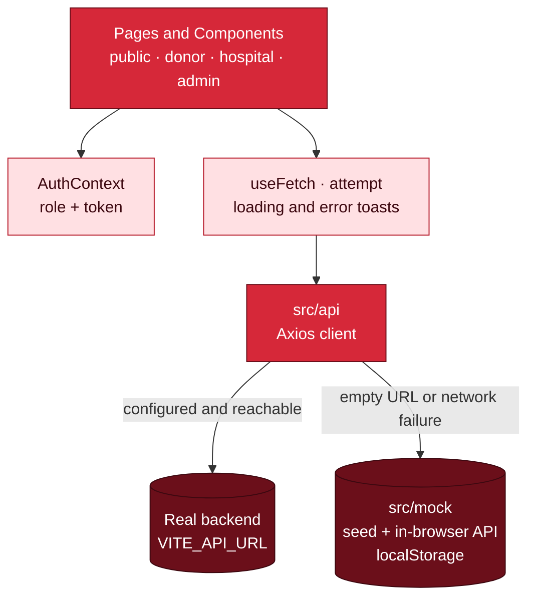

<div align="center">


<br/>


-F26471?style=for-the-badge)

### 🩸 *Hospitals raise a request → we match compatible, eligible donors in the same city → donors respond → donations & stock stay in sync.*

[**Quick start**](#-quick-start) · [**Demo logins**](#-demo-logins) · [**Flow**](#-how-it-works) · [**Features**](#-features-by-role) · [**Tech stack**](#-tech-stack) · [**API**](#-api-contract)

</div>

---

## 📖 Table of contents

- [Why RaktSetu?](#-why-raktsetu)
- [Quick start](#-quick-start)
- [Demo logins](#-demo-logins)
- [How it works](#-how-it-works)
- [Features by role](#-features-by-role)
- [Smart matching](#-smart-matching-engine)
- [Blood compatibility](#-blood-compatibility-built-in)
- [Design system](#-design-system-red-only)
- [Tech stack](#-tech-stack)
- [Architecture](#-architecture)
- [Project structure](#-project-structure)
- [API contract](#-api-contract)
- [Mock data](#-seeded-mock-data)
- [Guided demo script](#-5-minute-demo-script)
- [Accessibility & UX](#-accessibility--ux)
- [Roadmap](#-roadmap)

---

## 💡 Why RaktSetu?

> *Rakt* = blood · *Setu* = bridge

In an emergency, families scramble across phone calls and WhatsApp groups to find blood. RaktSetu turns that chaos into a **60-second workflow**:

| 😰 Today | 🩸 With RaktSetu |
|---|---|
| Calling dozens of people | One request, instant city-wide match |
| Unsure who is eligible | 90-day gap and group compatibility checked automatically |
| Donor phone numbers spread everywhere | Numbers revealed **only after a donor accepts** |
| Blood stock tracked on paper | Live inventory, thresholds, expiry alerts |
| No visibility for admins | Dashboards, reports and a full audit trail |

---

## 🚀 Quick start

```bash
# 1. install
npm install

# 2. run (opens on http://localhost:5173)
npm run dev

# 3. production build
npm run build && npm run preview
```

> **No backend required.** With `VITE_API_URL` empty, the whole app runs on a built-in mock backend that persists to `localStorage`. To reset the demo data, clear site data for the page.

<details>
<summary><b>🔌 Connect a real backend</b></summary>

```bash
cp .env.example .env
# then edit .env
VITE_API_URL=http://localhost:8080
```

- Requests go to your server through Axios (token sent as `Authorization: Bearer …`).
- Error bodies shaped `{ "message": "..." }` are shown as toasts.
- If the server can't be reached at all, calls **fall back to mock data** automatically.

</details>

---

## 🔑 Demo logins

Pick a role on the login page. A **"fill demo credentials"** button does the typing for you.

| Role | Username | Password | What you will see |
|:---:|:---:|:---:|---|
| 🩸 **Donor** | `donor` | `donor123` | Aarav Patel · Surat · O+ · eligible · 4 donations (Bronze, 1 away from Silver) · live incoming requests |
| ⏳ **Donor (cooldown)** | `donor2` | `donor123` | Priya Shah · A+ · countdown ring: *"Eligible again in 23 days"* |
| 🏥 **Hospital** | `hospital` | `hospital123` | Lifeline Multispeciality Hospital, Surat · low-stock B+ · units expiring soon · 4 requests in different states |
| 🛡️ **Admin** | `admin` | `admin123` | KPIs, 4 red charts, a pending hospital to approve, audit log |

> Every other seeded donor can log in with their **phone number** + `donor123`.

---

## 🧭 How it works

### The big picture



### Request lifecycle



### Who talks to whom



### User journey map



---

## ✨ Features by role

<table>
<tr>
<td width="33%" valign="top">

### 🌍 Public
- **Home**: hero + quick search, live counters, 8-group stock tiles, how-it-works, compatibility chart, urgent requests, camps, testimonials, FAQ
- **Find Blood**: filter by group, city, urgency · donor phones hidden
- **Camps**: filter by city and date, details modal, register
- **Stock**: hospital × blood-group table with low-stock flags
- **About**: eligibility, process, myths vs facts
- **Emergency request**: public form, 3 clicks from anywhere
- 404 page, skeleton loaders, empty states, toasts everywhere

</td>
<td width="33%" valign="top">

### 🩸 Donor
- **Overview**: circular eligibility countdown, availability toggle, totals, next-badge progress, latest request
- **Incoming requests**: Accept / Decline with confirmation; phone shown **only after Accept**
- **Donation history**: table + downloadable certificate
- **Badges**: 🥉 Bronze (3) · 🥈 Silver (5) · 🥇 Gold (10) + leaderboard
- **Profile**: edit details, preferred contact time, change password
- **Camps**: register for upcoming drives

</td>
<td width="33%" valign="top">

### 🏥 Hospital
- **Overview**: open · critical · today's donations · low-stock alerts · expiring units
- **Create request**: red urgency chips, validation, critical confirmation
- **My requests**: filter, search, sort, paginate
- **Request detail**: timeline, matched donors, Notify / Notify all, fulfil, cancel, **WhatsApp share**
- **Inventory**: 8-group grid, editable thresholds, unit-level table
- **Record donation**: donor search + server-style error toasts
- **Transfers** and **Reports** (+ CSV export)

</td>
</tr>
</table>

### 🛡️ Admin

| Tab | What you can do |
|---|---|
| **Dashboard** | KPI cards · stock by group (bar) · requests per month (line) · fulfilment rate (donut) · units by camp (bar) |
| **Hospitals** | Verification status, **Approve / Reject**, add a hospital |
| **Donors** | Search + filter by group, city, availability · view · deactivate · CSV export |
| **Requests** | All requests with filters and a **status override** |
| **Camps** | Create, edit, delete · see registrations and units collected |
| **Reports** | Monthly summary · print · CSV export |
| **Audit Log** | Who changed what and when, filterable by date and user |

---

## 🧠 Smart matching engine

A donor is matched to a request only if **all four** checks pass:



Results are ranked **exact matches first**, then by longest time since last donation.

---

## 🧬 Blood compatibility (built in)

Who can donate to whom. This same table powers both the matching engine and the Home page chart.

| Donor ↓ | A+ | A- | B+ | B- | AB+ | AB- | O+ | O- |
|:---:|:---:|:---:|:---:|:---:|:---:|:---:|:---:|:---:|
| **O-** | ✅ | ✅ | ✅ | ✅ | ✅ | ✅ | ✅ | ✅ |
| **O+** | ✅ | · | ✅ | · | ✅ | · | ✅ | · |
| **A-** | ✅ | ✅ | · | · | ✅ | ✅ | · | · |
| **A+** | ✅ | · | · | · | ✅ | · | · | · |
| **B-** | · | · | ✅ | ✅ | ✅ | ✅ | · | · |
| **B+** | · | · | ✅ | · | ✅ | · | · | · |
| **AB-** | · | · | · | · | ✅ | ✅ | · | · |
| **AB+** | · | · | · | · | ✅ | · | · | · |

---

## 🎨 Design system (red only)

No blue, green, yellow or purple anywhere: the Tailwind theme itself removes every other hue, including charts and status chips.

| Token | Hex | Token | Hex |
|---|---|---|---|
| `red-50` | `#FFF1F2` | `red-600` | `#D62839` |
| `red-100` | `#FFE0E3` | `red-700` | `#B71C2C` |
| `red-200` | `#FFC2C8` | `red-800` | `#8E1422` |
| `red-300` | `#FF97A1` | `red-900` | `#6B0F1A` |
| `red-400` | `#F26471` | `red-950` | `#3D0810` |
| `red-500` | `#E63946` | | |

**Meaning is never colour alone**: every chip carries an **icon + text label**.

| Chip | Look | Icon |
|---|---|---|
| Urgency **Normal** | `red-100` bg, `red-800` text | 🕐 clock |
| Urgency **Urgent** | `red-300` bg, `red-900` text | ⚠️ triangle |
| Urgency **Critical** | solid `red-700`, white text, **pulsing** | 🛑 octagon |
| Status **Open / Partial / Fulfilled / Cancelled** | graded reds, dashed outline for cancelled | ● ⏳ ✔ ✖ |

---

## 🛠 Tech stack

| Layer | Tools |
|---|---|
| **Framework** |   |
| **Routing** |  role-protected routes |
| **Styling** |  custom red tokens, glass cards, reduced-motion support |
| **Data** |  API layer + mock fallback |
| **Forms** |  inline validation |
| **Charts** |  graded red shades |
| **Icons & toasts** | `lucide-react` · `react-hot-toast` |
| **State** | React Context (auth + role) · token in `localStorage` |

---

## 🏗 Architecture



**Key idea:** every screen talks only to `src/api`. Swapping mock for a real backend needs no UI changes.

---

## 📁 Project structure

```text
raktsetu/
├── assets/banner.svg            ← animated README banner
├── public/favicon.svg
├── tailwind.config.js           ← red-only palette
├── .env.example                 ← VITE_API_URL
└── src/
    ├── api/                     client.js (Axios + fallback) · index.js (all endpoints)
    ├── mock/                    seed.js (data) · mockApi.js (in-browser backend)
    ├── context/                 AuthContext.jsx (role + token)
    ├── routes/                  AppRoutes.jsx · ProtectedRoute.jsx
    ├── layouts/                 PublicLayout · DashboardLayout
    ├── hooks/                   useFetch · useCountUp
    ├── utils/                   constants · helpers · notify
    ├── components/              Navbar · Sidebar · DataTable · Modal/ConfirmDialog
    │                            Chips (BloodGroupBadge, UrgencyChip, StatusChip)
    │                            Forms (FormInput, FormSelect, ToggleSwitch, Stepper)
    │                            Widgets (StatCard, StockTile, Timeline, CountdownRing)
    │                            Cards (RequestCard, CampCard, DonorCard) · StarterChart
    │                            RequestForm · Feedback (Skeleton, EmptyState) · Footer · Logo
    └── pages/
        ├── Home · FindBlood · Camps · Stock · About · Emergency · NotFound
        ├── Login · RegisterDonor (4 steps) · RegisterHospital
        ├── donor/DonorPages.jsx
        ├── hospital/HospitalPages.jsx
        └── admin/AdminPages.jsx
```

---

## 🔌 API contract

| Area | Endpoints |
|---|---|
| **Auth** | `POST /api/auth/login` · `POST /api/donors/register` · `POST /api/hospitals/register` |
| **Donors** | `GET /api/donors/:id/eligibility` · `PUT /api/donors/:id/availability` |
| **Requests** | `GET /api/requests?status=OPEN` · `POST /api/requests` · `GET /api/requests/:id` · `GET /api/requests/:id/matches` · `POST /api/requests/:id/notify` · `POST /api/requests/:id/fulfill` |
| **Donations & stock** | `POST /api/donations` · `GET /api/inventory` |
| **Camps** | `GET /api/camps` · `POST /api/camps` |
| **Insights** | `GET /api/reports/monthly` · `GET /api/stats` · `GET /api/audit` |

The UI also calls a few extra routes (donor responses, hospitals, transfers, thresholds, camp registration). They are all listed in [`src/api/index.js`](src/api/index.js).

**Error format the UI understands:**

```json
{ "message": "Donor donated within last 90 days" }
```

It appears as a prominent toast, for example when recording a donation.

---

## 🌱 Seeded mock data

| Entity | Count | Notes |
|---|:---:|---|
| 🩸 Donors | **40** | Surat, Ahmedabad, Vadodara, Mumbai, Pune · all 8 groups |
| 🏥 Hospitals | **8** | 7 approved, 1 pending (to try admin approval) |
| 🚨 Requests | **12** | Every status and urgency |
| 🏕 Camps | **6** | 4 upcoming, 2 completed |
| 📦 Inventory | every hospital × group | Some low-stock, some expiring or expired |
| 📜 History | per donor | Donations, transfers, audit entries |

---

## 🎬 5-minute demo script

1. **Public tour**: Home → Find Blood (filter `B+`, `Surat`) → Stock → Camps.
2. **Raise an emergency**: click **Emergency Request** → CRITICAL, Surat. Matching donors are notified automatically.
3. **Donor side**: log in as `donor` → **Incoming Requests** → **Accept** → the hospital phone is revealed only now.
4. **Hospital side**: log in as `hospital` → **My Requests** → open a request → **Notify all** → **Fulfil from inventory**.
5. **Break a rule on purpose**: **Record Donation** for `donor2` and watch the *"donated within last 90 days"* toast.
6. **Admin**: log in as `admin` → approve *Andheri Hope Hospital* → review charts → open the **Audit Log**.

---

## ♿ Accessibility & UX

- ✅ Max **3 clicks** to raise a request or register
- ✅ Mobile-first: tested layouts for **360px / 768px / 1280px**; dashboards switch to a **bottom nav** on phones
- ✅ Semantic HTML, labelled inputs, `aria-label` on icon buttons, red focus rings
- ✅ Status is **icon + text + intensity**, never colour alone
- ✅ Light animation (hover lift, fade-in, pulsing CRITICAL chip) that respects `prefers-reduced-motion`
- ✅ Inline validation: phone = 10 digits · age 18–65 from DOB · units 1–10 · required fields · submit disabled while loading · input preserved on error

---

## 🗺 Roadmap

- [ ] Real backend (Spring Boot / Node) behind the existing API layer
- [ ] SMS / WhatsApp / push notifications for matched donors
- [ ] Map view and real distance matching
- [ ] Multi-language UI (Hindi, Gujarati, Marathi)
- [ ] Automated tests and CI

---

<div align="center">

### 🩸 Donate blood, save lives.

*Built as a bridge between those who can give and those who cannot wait.*

<sub>Demo project · all data is fictional</sub>

</div>

